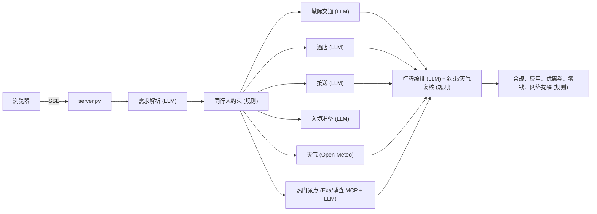

# 行程规划 · 多 Agent（商务 / 家庭游 / 入境游，Ada claude-sonnet-5）

一句自然语言需求（中、英、日、韩均可），10 个 Agent 协作生成：目的地逐日、分时段天气，同行人约束，相似游客的热门景点和合作优惠券，城际交通，酒店，接送，**按天气安排**的逐日行程，合规检查，费用分摊；入境游客还会得到网络变化提醒（附携程官方指南链接）、人民币零钱建议、入境准备清单、支付计划和双语沟通卡。另有三个按需工具：入境游问答、小票识别记账、多语言分享文案。

机票、酒店、景点、餐厅和优惠券均为**演示数据**，不会真实预订；天气和网页检索是实时数据。

## 本版新增

| 需求 | 实现 |
|---|---|
| 根据天气自动安排多天行程，以及一天中不同天气、温度的安排 | `weather.py` 调用 Open-Meteo（无需 key）：16 天内用实时逐小时预报，更远的日期用去年同期实测作参考，网络不可用时用演示数据。每天分为早上、上午、午间、下午、晚上 5 个时段，雷暴、降雨（概率 ≥ 60% 或 ≥ 1 mm）、体感 ≥ 33°C、大风的时段判为不宜户外；毛毛雨只提醒带伞。天气按时段传给行程编排 Agent，生成后再由规则复核：户外景点如果落在不宜户外的时段，自动换成未安排的室内景点；没有可替换的则在“天气适配”检查中提醒。另外输出穿衣建议、温差、防晒、雨具和预警。 |
| 根据入境客户的网络变化，给出携程官方指南链接 | `tips.network_timeline` 按行程生成网络变化时间线：出发前、落地切换漫游或 eSIM、连接酒店 Wi-Fi、高铁途中、郊区景区、分享内容、返程前。每一项说明影响和应对方法，并附携程官方指南（按游客语言选择，没有对应语言时用英文）。链接均于 2026-10-11 实际访问核实。 |
| 根据人数、时间、地点提醒兑换人民币零钱，并给出理由 | `tips.cash_advice` 按天、按地点估算：饮用水和零食、老街夜市、寺庙、郊区景区、不收境外卡的餐厅、出租车、应急备用金，每一项都写明理由；总额取整到 50 元（300–5000 元），并给出 10、20、50、100 元面额的拆分。 |
| 用 Exa 和博查 MCP 检索相似游客行程，推荐热门景点，并提供合作景点优惠券 | `websearch.py` 通过 MCP（Streamable HTTP，`mcp_client.py`）并行调用 Exa 和博查，检索词由出发地、目的地、天数和出行类型组成。`recommend.py` 统计景点被提及的次数，再由模型排名并总结行程规律；景点 id 和来源编号都会校验，无效的直接丢弃。热门景点会标注是否已排进行程、是否因同行人约束被排除，并附来源链接。合作景点优惠券（`data.COUPONS`）按受众（家庭、入境游客）和人数判断是否可用，计算本次可省金额，费用中扣除，并在支付计划的预付项里注明。 |

## 架构



| Agent | 类型 | 职责 |
|---|---|---|
| 需求解析 intake | LLM | 出行类型、入境游、成员年龄/行动/过敏/饮食/所属家庭、预算币种；读取家庭档案 |
| 同行人约束 constraints | 规则 | 推导硬约束，过滤景点和餐厅 |
| 城际交通 / 酒店 / 接送 | LLM | 只能从过滤后的候选中按 id 选择，无效 id 回退 |
| 入境准备 inbound | LLM | 签证、支付、网络、证件、应急清单，每条必须引用知识库 |
| **天气 weather** | API + 规则 | 逐日、分时段天气，判断是否适合户外，生成穿衣与预警 |
| **热门景点 trending** | MCP + LLM | 检索相似游客攻略 → 排名 → 优惠券 |
| 行程编排 itinerary | LLM + 规则复核 | 按天气、热度和约束排程；复核景点数、步行、过敏原、天气 |
| 合规与费用 check | 规则 | 政策、班次、约束、天气适配、预算；费用和优惠券；零钱建议；网络时间线；支付计划 |

## 运行

需要一个兼容 Anthropic Messages API 的模型服务（`ADA_TOKEN`，可选 `ADA_BASE_URL` 指向自建网关）；天气和 Exa 需要能访问公网。项目自带虚拟环境，只依赖 `anthropic==0.40.0`（见 `requirements.txt`）。

首次安装：

```bash
cd travel-planner-ui-intelligence
python3 -m venv .venv
. .venv/bin/activate
pip install -r requirements.txt
# 如果 pypi.org 连不上（例如代理返回 502），可以改用阿里云镜像：
# pip install -i https://mirrors.aliyun.com/pypi/simple/ -r requirements.txt
```

启动：

```bash
cd travel-planner-ui-intelligence
. .venv/bin/activate
export ADA_TOKEN=<your-api-key>
# export ADA_BASE_URL=<your-gateway-base-url>   # 可选；不设置则使用 Anthropic 官方地址
# 可选：启用博查（二选一）
# export BOCHA_API_KEY=<your-bocha-key>          # 直接调用博查 Web Search API（与官方 bocha-search-mcp 相同的接口）
# export BOCHA_MCP_URL=<remote-bocha-mcp-url>    # 远程博查 MCP Server，工具名 bocha_web_search
python server.py                       # http://127.0.0.1:8000
```

| 环境变量 | 说明 |
|---|---|
| `ADA_TOKEN` | 必填：模型服务的 API key |
| `ADA_BASE_URL` | 可选：Anthropic 兼容网关地址，不设置则使用官方地址 |
| `ADA_MODEL` | 可选：模型 id，默认 `claude-sonnet-5` |
| `EXA_API_KEY` | 可选。Exa 托管 MCP 不带 key 也能用（限速较低） |
| `EXA_MCP_URL` | 可选，默认 `https://mcp.exa.ai/mcp` |
| `BOCHA_API_KEY` / `BOCHA_MCP_URL` | 博查：未配置时页面显示“未配置”，只用 Exa |
| `WEATHER=off` | 不联网取天气，使用演示数据 |
| `WEB_SEARCH=off` | 不做网页检索，热门景点使用内置热度 |
| `PORT`、`HOST`、`MEMORY_DIR`、`ADA_TIMEOUT`、`ADA_THINKING` | 端口、监听地址、档案目录、模型超时、是否关闭 thinking |

一次规划约 30–45 秒。热门景点检索约 13 秒，与交通、酒店等 Agent 并行执行。

## 测试

离线测试（假模型，`WEATHER=off`、`WEB_SEARCH=off`，不需要 token 和网络）：

```bash
python -m unittest discover -s tests -v
```

共 39 个测试。新增覆盖：天气时段判定（降雨、高温、毛毛雨）；预报、去年同期、演示数据的切换；雨天把户外景点换成室内景点、晴天保持不变；兜底行程在雨天优先安排室内景点；用本地假 MCP 服务验证 SSE 解析、会话失效后重新初始化、多来源去重；Exa 和博查结果解析（过滤非 http 链接）；博查未配置时的状态；热门景点排名中无效 id 和来源编号的过滤；被同行人约束排除的热门景点；优惠券受众、人数、免票和金额计算；零钱面额合计等于总额、郊区景区和不收境外卡的餐厅；网络提醒链接全部为 trip.com，并按语言选择。

## 安全与合规

- 网页检索结果作为不可信数据：只传标题和摘要，提示词要求模型不执行其中的指令；模型返回的景点 id 和来源编号都要校验；页面上的链接只渲染 https。检索词只包含城市、天数和出行类型，不含出行人信息。
- 网络提醒只建议漫游、eSIM 和离线准备，不推荐任何跨境访问工具。
- 服务默认只监听 `127.0.0.1`，没有鉴权；家庭档案、小票、导出 CSV 的处理与上一版相同。
- 天气数据来自 Open-Meteo（CC BY 4.0），页面上有署名。

## 已知限制

- 优惠券、库存、价格、汇率为演示数据；携程指南链接需要定期核实。
- Open-Meteo 预报最长 16 天，更远的日期只能参考去年同期。
- 景点目录覆盖 7 个城市；检索发现的目录外地点只展示，不排进行程。
- 博查需要 API Key（或远程 MCP 地址）才能启用。

## 界面语言

页面右上角可以切换「中文 / EN」，选择会保存在浏览器里（第一次访问时按浏览器语言决定）。切换后标题、按钮、表头、标签、Agent 进度、天气、网络提醒、零钱建议和示例需求都会换成对应语言，已生成的行程直接按新语言重新渲染，不需要重新规划。

模型生成的内容（行程标题和条目、Agent 理由、热门景点分析、入境清单）按出行人使用的语言输出；规则引擎生成的约束说明和检查详情、演示数据里的酒店和餐厅名称目前只有中文。

前端文件：`static/index.html`（页面结构）、`static/i18n.js`（中英文文案和翻译函数）、`static/app.js`（渲染和交互）。服务端只对外提供这三个文件。
